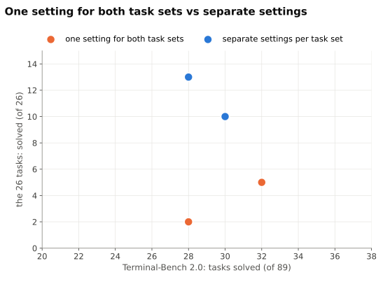
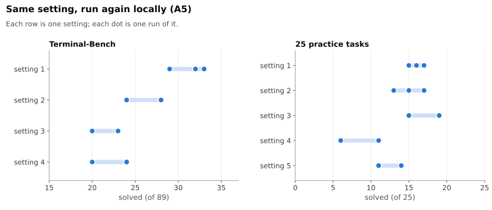
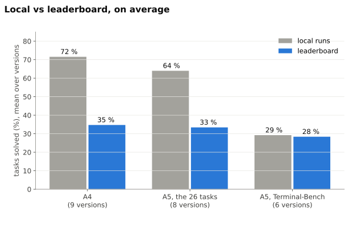

From assignment 2 to assignment 5, we built an increasingly complex coding agent, starting with a simple agent loop to a harness and a serving system. In assignment 2, we built an agent loop. In assignment 3, we tried orchestrating different models to build a harness, considering cost and time constraints. In assignment 4, we developed the harness further and built a serving system to improve throughput. In assignment 5, we tried to make the coding agent more generalizable by getting it to perform well on two tasks.

Across these assignments and the sharing sessions, I learnt a lot about harness design and serving systems. The following are five lessons I learnt, ranging from broad agent design choices to specific techniques for improving prefix cache hits.

<!--more-->

## Techniques by assignment (Accumulative)

| Assignment | Layer | Techniques |
|---|---|---|
| Assignment 2 | Harness | Agent tool loop from read code to run commands to edit files Safety guards |
| Assignment 3 | Harness + Model Orchestration | Planner-Implementer-Debugger Architecture Proactive Context Compaction Retries |
| Assignment 4 | Serving engine + harness | HRRN scheduling HiCache Allocating Mamba slots MTP speculative decoding Explore-then-Work Architecture Retries with notes Done Gate|
| Assignment 5 | Serving engine + harness | Separate time limits per Task type Thinking budget cap Adaptive Thinking Mode Evidence-based finish check |

## Lesson 1: Tradeoff between generalization and specialization

It is hard to get good results on different tasks using the same harness setting, especially when two tasks have different characteristics. This is the lesson that I learnt from assignment 5. 

Initially, there was a 30 minute limit for every task. This worked well for TB, solving about 32 tasks in around 1.5 hour, but the 26 task score was only 5. Observing the tradeoff, later, I used shorter limits of around 20 minutes for TB while keeping a separate long path for the 26 tasks. This made TB much faster, while the 26-task results stayed around 13. 

It was hard to have the same harness for these two tasks since these tasks’ needs are different. For the terminal bench, I am aiming for the fast track. The harness solves most of the tasks with a 18 minutes cap at most. However, the 26 tasks need about 30-100 minutes. Therefore, Setting shorter finishing time to achieve better performance on TB only hurts the performance of 26 tasks, since they did not have enough time.

Given this, I eventually keep a general harness but let it use different time budgets based on the task characteristics. Using one global setting to make everything faster can lose the tasks that need longer.

## Lesson 2: Transferability from local to leaderboard

Across multiple assignments, transferability from local to leaderboard and the noise in the performance have always been a problem, since the local tests and leaderboard tests are different, and the coding agent itself is random. Transferability only improved when the local and online tasks were the same.

In assignment 3, the variations exists between runs in both local tests and online tests. For example, I tried the same zip. One scored 13 while the other one scored only 9. This is because different tasks in the local tests and leaderboard tests are different, and the harness is not robust enough. In assignment 4, the problem was still there. The same code scored 16, 13, and 14 online. In assignment 5, TB used the same tasks locally and online, which made the local results more useful. However, it was still noisy. The same zip scored 32 and then 30 on leaderboard, and local repeats could differ by 5 solves. Ruling out the different tasks, this situation shows the variation caused by the design of harness and serving system. The detail information can be seen in the plot below.

Given the randomness and the transferability issue, what I learned is to test several times instead of choosing a version from one good run, since, if the version is not stable, the online run is just a random draw. To counter the randomness, I also use a small probing set before running the whole suite. For these early probes, I would focus more on tasks that can distinguish the versions, rather than repeatedly spending time on tasks that always pass. After passing the probe, I would then test the version using all the tasks for the final comparison and evaluation.

## Lesson 3: Prefix Cache Hit plays a key role in serving improvements

I found that prefix cache hit was an important part of serving speed in assignments 4 and 5. Coding agents repeatedly send much of the same context. Losing that cached context would make the whole system slow since it needs to process the context again. Furthermore, the importance of the prefix cache hit is also shown in assignment 3, since assignment 3 has discounted cached tokens in its billing.

Given its importance, in assignment 4 and 5, I tried several techniques on improving the prefix cache hit. The first one is HRRN. Instead of using FIFO, HRRN changed which request ran next and help the system reuse a prefix before it was evicted. The second one is HiCache. It keeps evicted prefixes in CPU memory so that later we can reuse it. Additionally, I also tried to allocating mamba slots on demand so as to enlarge the KV cache from  391k to 468k tokens. With these scheduling and cache changes together, the assignment 4 cache hit rate increased from 5% to 85%, improving the serving speed a lot. The same architecture and techniques are used and adjusted in assignment 5.

However, there is a tradeoff between the number of tasks running concurrently and cache reuse. Opening too many tasks can push earlier prefixes out of the cache. Meanwhile, opening fewer tasks can make each task faster, but leave less work running in parallel and increase the overall time. Thus, simply adding concurrency limit cannot speed up the whole process, if there are a lot of tasks. In assignment 4, I tried opening more tasks first to solve the easy tasks first, then reducing concurrency to spend more time on the remaining tasks. However, in assignment 5, without evaluation, it was also harder to know which solutions were correct and which tasks needed another attempt.

Additionally, other than previous tradeoff, there was another tradeoff with MTP. It made decoding about 1.5 times faster, but it used memory that could hold KV cache. This could cause more eviction and reprocessing, slowing the whole request. In my runs, MTP did not clearly improve the number of tasks solved.

What I learned is that I need to measure the whole agent run. Faster decoding or more concurrent tasks can look good individually, but their value depends on how they affect cache reuse and waiting time.

## Lesson 4: Retries are useful when we have feedback

By trying different retry methods in assignments 4 and 5, I learned that retries need a useful signal to help the agent decide when to restart and what to change.

In assignment 4, I tried retries with a fresh environment and a learning book recording what had been tried and what had failed. The best results came from this version, which implies that it is useful. I also tried adding more fresh restarts and giving another chance on top of the current code. These did not have significant improvement on the performance.

However, when I moved this approach to assignment 5, it did not improve the results. An important difference is that assignment 4 provided evaluation feedback, so the agent knew when its solution failed. In assignment 5, we did not have that signal to guide retries. Observing that most unresolved tasks failed new tests, it was hard for the agent to tell whether it should submit or try again. I tried to provide the signal by making the success criteria clearer at the beginning. However, the writing tests produce a lot of false alarms.

Given this, I learnt that the design of adding retries is based on whether the feedback is available and reliable. 

## Lesson 5: Choose a harness the model can actually use

By moving the harness from assignment 3 to assignment 4, I noticed that the same structure can have different results depending on the model.

In assignment 3, I had a planner-implementer structure with expert and standard models. Using expert for early guidance improved the result from 7 to 13 solves. However, in assignment 4, we only had the standard model. With the same structure, it did not provide us with much gain, since, sometimes, the planner supported by standard model cannot provide the plan in fixed turns. Thus, for the later versions in assignment 4, I used a simpler structure, as explorer-implementer structure. I focused more on exploring the codebase and then working directly, instead of asking the model to form a separate plan first.

I learned that I should choose the structure based on what the model can actually do. For a weaker model,  we need to have a simpler workflow and monitor its output more closely. If a stronger model is available, then we can have the planner-implementer structure or subagent structure to let it provide guidance to the weaker implementer.

## What I would do differently

The first thing I would do differently is how I organize the development loop. I would first conduct research on existing harness designs and gain insights from them. Then I would outline the overall scope and directions to explore, letting each session focus on one direction and letting them communicate to each other once in a while. For each session, I would let them follow a iterating loop of forming a hypothesis, designing a change, testing it across several runs, reviewing the results, and providing feedbacks. Dividing them into different sessions help me keep track of the improvements caused by different directions. The iterating loop also can ensure the reliability of the result that I receive.

The second thing I would do differently is how I iterate on versions. I would test each version for at least three runs before deciding whether it is an improvement, rather than making the call based on a single result.

## AI use

Across assignments, we mainly use claude code for coding and reviewing the code. Sometimes, we will also involve codex for critic the harness and provide insights.

For blog, we use claude code to generate the graphics, collect data, and code up the blog. It did not write the text. It checked the numbers against my records and drew the figures.
